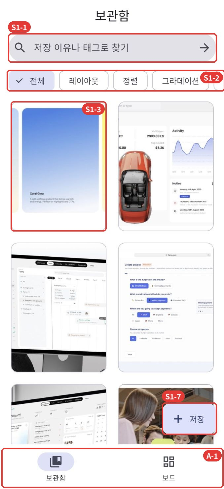
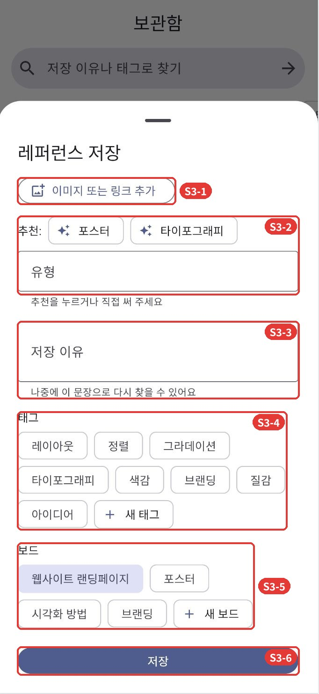
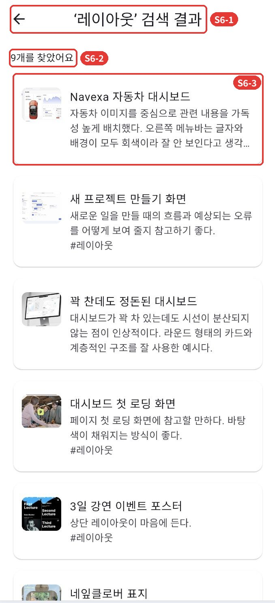
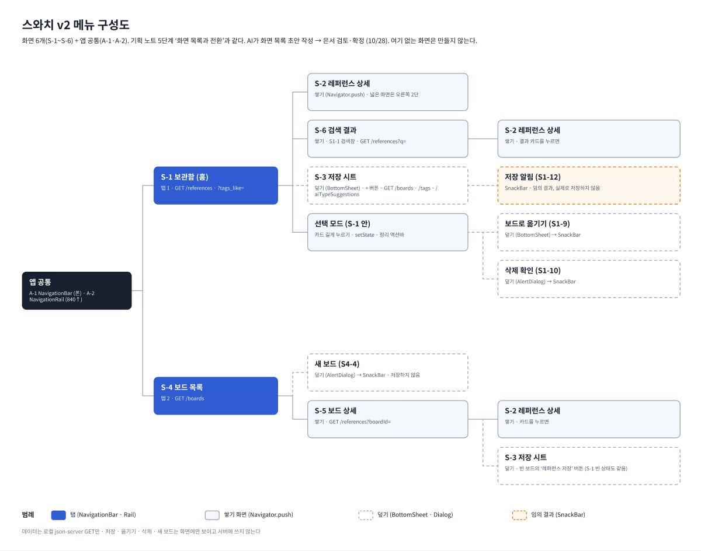

# 스와치 v2 — 좋은 디자인을 모으고, 이유를 기록하다

GAI3008-01 응용모바일프로그래밍 중간 프로젝트 · 1인 1팀 · 은서

## 앱 소개

| 칸 | 내용 |
| --- | --- |
| 앱 이름 | 스와치 |
| 부제 | 좋은 디자인을 모으고, 이유를 기록하다 |
| 카테고리 | 생산성 |
| 대상 사용자 / 사용 상황 | UI를 직접 짜는 프론트엔드 개발자 · 이동 중 폰으로 저장하고, 작업할 때 노트북·태블릿에서 꺼내 본다 |
| 스크린샷 |    — 전체는 [docs/screenshots](docs/screenshots) |
| 설명 | 포스터 · 웹/앱 디자인 · 타이포그래피 레퍼런스를 모으고 어떤 지점이 좋은지 기록하는 앱. 비교 앱 Pinterest는 저장은 쉽지만 다시 찾기 어렵고, 내 보드에 추천·광고가 끼어들며, 저장한 이유를 남길 곳이 없다. |
| 새로운 기능 | P06 저장 이유 + 태그, 태그·이유로 다시 찾기 · P08 내가 저장한 것만 보이는 보관함 · P07 여러 개 선택해 한 번에 정리 |
| 평가 및 리뷰 | Pinterest App Store 한국 ★4.7 (15만 개, 2026-10-27 확인) · 분석 리뷰 500건 |

현행 유사 앱: Pinterest · v2 한 문장: 저장 다음, 이유를 남기고 다시 찾는다.

## 실행 방법

터미널 1 — 목업 서버 (Node.js 18 이상)

```bash
cd mock_server
npm i
npm run mock          # http://localhost:3000  (GET만 사용)
curl http://localhost:3000/references
```

목업 데이터(`mock_server/db.json`): 은서가 Figma ‘레퍼런스 모으기’에 모아 둔 레퍼런스 20개와 그때 적어 둔 저장 이유(문장만 다듬음), 보드 4개(‘브랜딩’은 빈 상태 시연용), 태그 8개, 유형 AI 추천 가짜 응답(`/aiTypeSuggestions`). 이미지는 `mock_server/public/images/`에 있고 json-server가 같은 주소(`http://localhost:3000/images/r01.jpg`)로 내려 준다. 이미지 출처: Pinterest (r14–r17 네 장은 Behance). 수업 시연용 레퍼런스이며 저작권은 각 원작자에게 있다.

터미널 2 — 앱 (처음 한 번은 플랫폼 폴더를 만든다)

```bash
flutter create --project-name swatch_v2 --platforms=web,macos,android .   # 처음 한 번만, 기존 파일은 그대로 둔다
flutter pub get
flutter run -d chrome
# Android 에뮬레이터
flutter run -d emulator-5554 --dart-define=API_BASE=http://10.0.2.2:3000
```

발표 데모용 상태 스위치

```bash
flutter run -d chrome --dart-define=DEMO_STATE=slow    # 2초 로딩
flutter run -d chrome --dart-define=DEMO_STATE=error   # 오류 + 다시 시도
flutter run -d chrome --dart-define=DEMO_STATE=empty   # 빈 상태
```

## 배포 (Vercel)

데이터는 GET만 쓰므로 목업 서버도 읽기 전용으로 배포한다. 두 프로젝트로 나눈다.

1. 목업 서버 — `mock_server/api/index.js`가 같은 `db.json`을 json-server로 내려 준다. `readOnly: true`라 POST · PUT · DELETE는 403으로 막힌다.

   ```bash
   cd mock_server
   npx vercel --prod          # 처음이면 로그인 · 프로젝트 이름(예: swatch-api)을 묻는다
   curl https://<api 주소>/references?q=미니멀
   ```

2. 앱 — Flutter 웹을 로컬에서 빌드해 정적 파일만 올린다.

   ```bash
   flutter build web --release --dart-define=API_BASE=https://<api 주소>
   cd build/web
   npx vercel --prod          # 프로젝트 이름(예: swatch)
   ```

배포 URL: (배포 후 적기)


## 화면 목록 (기획 노트 5단계와 같은 번호)



메뉴 구성도: AI가 화면 목록 초안 작성 → 은서 검토·확정 (Figma ‘스와치 v2 메뉴 구성도’).

| 번호 | 비즈니스 명칭 | 파일 | 전환 | GET |
| --- | --- | --- | --- | --- |
| S-1 | 보관함 | lib/screens/library_screen.dart | 탭 | /references, ?tags_like= |
| S-2 | 레퍼런스 상세 | lib/screens/reference_detail.dart | 쌓기 · 넓은 화면 2단 | — |
| S-3 | 저장 시트 | lib/screens/save_sheet.dart | 덮기 | /boards, /tags |
| S-4 | 보드 목록 | lib/screens/boards_screen.dart | 탭 | /boards |
| S-5 | 보드 상세 | lib/screens/board_detail_screen.dart | 쌓기 | /references?boardId= |
| S-6 | 검색 결과 | lib/screens/search_result_screen.dart | 쌓기 | /references?q= |

빈 상태 확인: 보드 탭 → ‘브랜딩’(비어 있는 보드) · 보관함에서 없는 단어로 검색.
적응형: 창 너비 720 이상이면 보관함 목록 + 상세 2단, 840 이상이면 왼쪽 NavigationRail.

## 상태관리 포인트 (표시만, 구현하지 않음)

코드의 `// STATE:` 주석 — 선택한 태그 → 레퍼런스 그리드 · 선택 목록 → 정리 액션바 · 저장 시트 입력값 → 저장 버튼.

## 데모

- 데모 영상 1분: https://youtu.be/gx2-YEAUiAY

## AI 사용

- `AGENTS.md` — AI 가드레일 (UI만, GET만)
- `docs/prompt-log.md` — AI에게 반론 · 생성을 요청한 기록
- `docs/셀프논증.md` — 쟁점별 주장 · 반론 · 결론
- 기준점 태그: `v1-plan` (화면 기획 확정 시점)

## 감점 점검

```bash
grep -rnE "http\.(post|put|patch|delete)|SharedPreferences|sqflite|hive|FirebaseAuth|ChangeNotifierProvider|Riverpod|BlocProvider" lib/ pubspec.yaml
# 결과가 비어 있어야 한다
```
