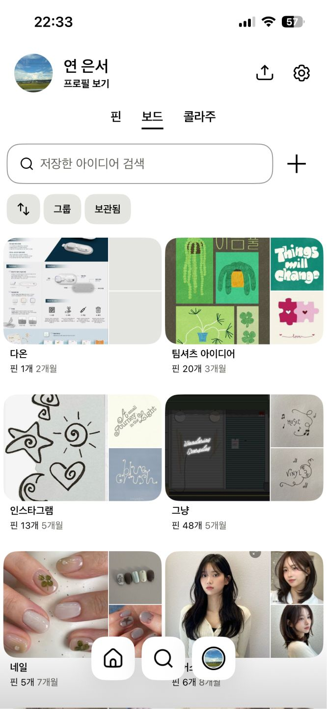
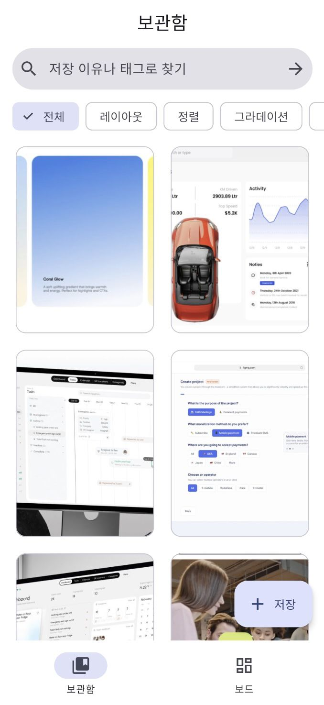
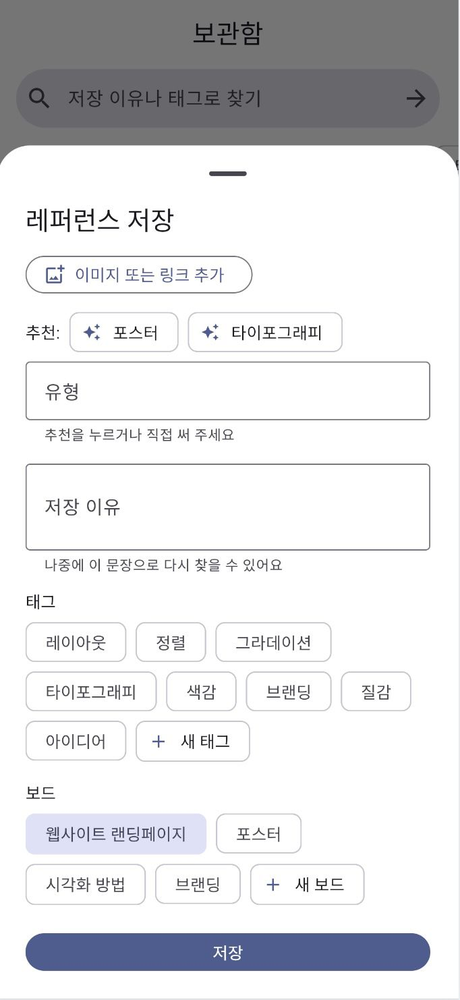
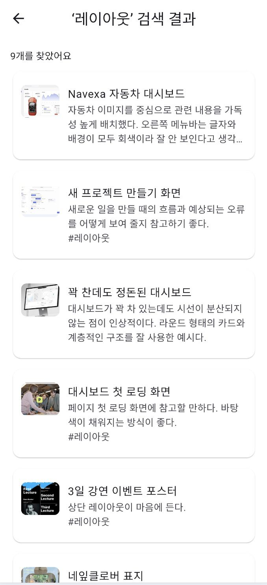
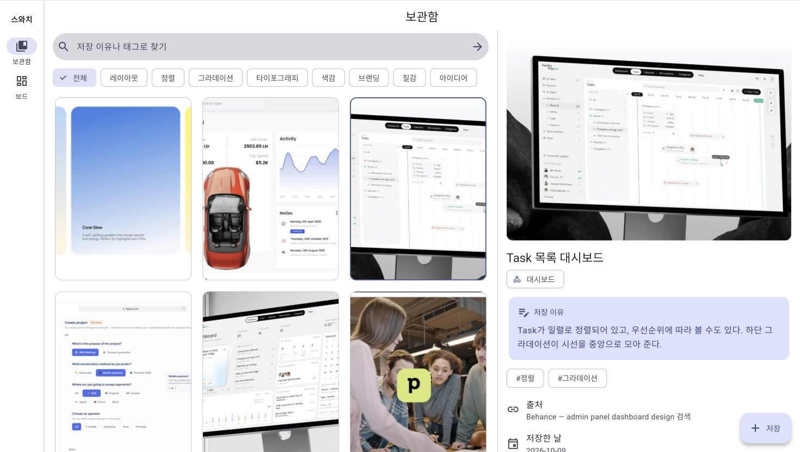

# 스와치 v2 — GAI3008 중간프로젝트 저장소 (1인 1팀)

## 앱 소개

> 칸 이름과 순서는 발표 자료의 "앱 소개" 장과 같습니다.

### 앱 이름
스와치 v2

### 부제
좋은 디자인을 모으고, 이유를 기록하다

### 카테고리
생산성

### 대상 사용자 / 사용 상황
- 대상 사용자: 디자이너 없이 UI를 직접 짜는 프론트엔드 개발자 — 포스터 · 앱 화면 · 타이포그래피를 참고용으로 모은다
- 사용 상황: 이동 중 폰으로 좋은 디자인을 발견하면 저장하고, 프로젝트를 시작할 때 노트북 · 태블릿에서 다시 꺼내 본다

### 스크린샷
왼쪽부터 v1(현행 Pinterest) → v2. 화면별 전체 캡처는 [docs/screenshots](docs/screenshots).

| v1 현행 | v2 화면 A | v2 화면 B | v2 화면 C | v2 넓은 화면 |
|---|---|---|---|---|
|  |  |  |  |  |
| Pinterest 내 보드 (현행) | S-1 보관함 | S-3 저장 시트 | S-6 검색 결과 | S-1 넓은 화면 2단 |

### 설명
1. 포스터 · 웹/앱 디자인 · 타이포그래피 레퍼런스를 모으면서, 어떤 점이 좋았는지 저장 이유를 함께 기록하는 앱이다.
2. 현행 Pinterest는 저장은 쉽지만 다시 찾기 어렵고(저니 감정 최저점 — “찾고 싶은 핀이 어디 있는지 잘 모르겠어요” 2026-08-14 ★5), 내 보드에 추천 · 광고가 끼어들며, 저장한 이유를 남길 곳이 없다.
3. v2의 핵심 가치: 모으고(저장하며 이유 · 태그를 남긴다) · 찾고(이유 · 태그로 다시 찾는다) · 묶는다(프로젝트별 보드로 한 번에 정리한다).

### 새로운 기능
v2에서 바뀐 것 3개 — 원칙 카드(`docs/원칙카드.md`)의 P번호와 연결합니다.

| P번호 | 바뀐 것 (화면 · 요소 번호) | 근거 (리뷰 · 원칙) |
|---|---|---|
| P06 | 저장 시트 S3-3 ‘저장 이유’ · 상세 S2-3 · 보관함 검색 S1-1 → 검색 결과 S6-3에 이유 문장 | “이 사진의 어떤 점이 좋았는지 사진마다 구체적으로 메모를 하고 싶습니다.” ★5 · 2026-01-16 — 기억보다 인식 |
| P08 | 보관함 S1-3 — 내가 저장한 것만 사진으로 (추천 · 광고 없음) | “내가 저장해놓은 사진들 보려고 들어갔는데 왜 more idaes가 먼저 나오는 거죠?” ★3 · 2025-12-08 — 미니멀 디자인 |
| P07 | 보관함 S1-4 선택 모드 · S1-5 정리 액션바 — 여러 개를 한 번에 옮기기 · 지우기 (결과는 화면 표시만) | “여러개 선택되서 지우기 같은 기능이 없는 건가요?” ★5 · 2026-02-15 — 유연성과 효율성 |

### 평가 및 리뷰
| 항목 | 내용 |
|---|---|
| 현행 별점 | ★ 4.7 (App Store 한국) · ★ 3.7 (Google Play 한국) |
| 리뷰 수 | App Store 한국 약 15만 개 — 분석은 최근 리뷰 500건 + Google Play 500건 교차 확인 |
| 대표 리뷰 | “제가 저장한 핀에 대하여 저 혼자만 볼 수 있는 메모를 적는 기능을 원합니다. 이 사진의 어떤 점이 좋았는지 사진마다 구체적으로 메모를 하고 싶습니다.” — ★5 · 2026-01-16 (작성자 이름 지움) |
| 출처 | App Store [Pinterest](https://apps.apple.com/kr/app/pinterest/id429047995) · Google Play Pinterest · 2026-10-27 확인 |

---

## 작성자 · 제출 정보

| 칸 | 내용 |
|---|---|
| 현행 앱 | Pinterest ([App Store](https://apps.apple.com/kr/app/pinterest/id429047995)) |
| v2 한 문장 | 저장 다음, 이유를 남기고 다시 찾는다 |
| 작성자 | 연은서 · 1인 1팀 (각자 제출) |
| 데모 | 데모 영상 1분 https://youtu.be/gx2-YEAUiAY · 배포 URL https://swatch-app-kappa.vercel.app |
| AI 사용 | 규칙 `AGENTS.md` · 기록 `docs/prompt-log.md` · 셀프 논증 기록 `docs/셀프논증.md` · 기획 확정 태그 `v1-plan` |

> 이 저장소는 **UI만 구현**합니다(중간고사 안내문 5장). 보이기는 다 동작하는 것처럼, 실제 동작(저장 · 로그인 · 결제 · 실제 계산)은 없습니다. 저장 · 옮기기 · 삭제 · 새 보드는 SnackBar로 결과만 보여 줍니다.
> 이 저장소는 수업 템플릿 [mid-project-template](https://github.com/xide-projext/mid-project-template)의 구조(`lib/api.dart` · `widgets.dart` · `mock_server/` · `docs/`)를 바탕으로, 화면 A·B·C를 스와치의 화면 S-1~S-6으로 바꿔 만들었습니다.

---

## 0. 폴더 이름 · 앱 이름

- 저장소 이름: `swatch` · 패키지 이름: `swatch_v2`
- 화면에 보이는 이름 ‘스와치’: `lib/main.dart`(`MaterialApp(title: …)`) · `web/index.html`의 `<title>`
- ⚠ 경로에 한글이 있으면 `flutter analyze`가 멈출 수 있습니다(템플릿 README 0장). clone은 `~/dev/` 같은 영문 경로에 받는 것을 권장합니다.

## 1. 실행 방법 — 터미널 2개

준비물: Flutter(Dart SDK ^3.10), Node.js 18 이상.

**터미널 1 — 목업 서버(json-server)**

```bash
cd mock_server
npm install && npm start                 # http://localhost:3000  (npm run mock 도 같음)
curl http://localhost:3000/references    # 확인: 레퍼런스 20개 JSON 배열이 나오면 성공
```

**터미널 2 — 앱**

```bash
flutter pub get && flutter run    # 저장소 루트(pubspec.yaml 있는 곳)에서
flutter run -d chrome             # 웹으로 볼 때
```

| 실행 대상 | 앱이 부르는 주소 | 따로 할 일 |
|---|---|---|
| Chrome · macOS · iOS 시뮬레이터 | `http://localhost:3000` | 없음 |
| **Android 에뮬레이터** | **`http://10.0.2.2:3000`** | 없음 — `lib/api.dart`가 Android면 자동으로 10.0.2.2를 씀 |
| 실기기(같은 Wi-Fi) | PC IP | `flutter run --dart-define=API_BASE=http://192.168.0.10:3000` |
| Vercel 배포(가산) | 배포 주소 | `--dart-define=API_BASE=https://swatch-mockserver.vercel.app` — `mock_server/README.md` 5장 |

- 서버가 꺼져 있으면 앱은 **오류 화면 + "다시 시도"**를 보여 줍니다.
- 목업 데이터(`mock_server/db.json`): 레퍼런스 20개와 그때 적어 둔 저장 이유(문장만 다듬음), 보드 4개(‘브랜딩’은 빈 상태 시연용), 태그 8개, 유형 AI 추천 가짜 응답(`/aiTypeSuggestions`). 이미지는 `mock_server/public/images/`에 있고 json-server가 같은 주소(`http://localhost:3000/images/r01.jpg`)로 내려 줍니다.
- 이미지 출처: Pinterest (r14–r17 네 장은 Behance). 수업 시연용 레퍼런스이며 저작권은 각 원작자에게 있습니다.

### 상태 화면 시연 — `DEMO_STATE` (발표 · 영상용)

```bash
flutter run -d chrome --dart-define=DEMO_STATE=loading   # 2초 로딩 (slow 도 같음)
flutter run -d chrome --dart-define=DEMO_STATE=error     # 오류 + 다시 시도
flutter run -d chrome --dart-define=DEMO_STATE=empty     # 빈 상태
```

빈 상태는 서버를 켠 채로도 볼 수 있습니다: 보드 탭 → ‘브랜딩’ · 보관함에서 없는 단어로 검색.

## 2. 구조

```
swatch/
├── README.md                 # 실행 방법 [필수]
├── AGENTS.md                 # AI 가드레일 (UI만, GET만) — CLAUDE.md는 이 파일을 따른다는 한 줄
├── pubspec.yaml              # 추가 패키지는 http 하나 · 한글 폰트(Noto Sans KR) 번들
├── lib/
│   ├── main.dart             # 앱 뼈대 · 탭(NavigationBar/Rail) · 테마
│   ├── api.dart              # GET만 · API_BASE · DEMO_STATE
│   ├── models.dart           # JSON → 객체 (Reference · Board)
│   ├── widgets.dart          # LoadingView · ErrorView · EmptyView · 레퍼런스 카드
│   └── screens/
│       ├── library_screen.dart        # S-1 보관함 — GET /references, 3상태, 720 2단 · 840 Rail
│       ├── reference_detail.dart      # S-2 레퍼런스 상세 — 쌓기(push) · 넓은 화면은 오른쪽 2단
│       ├── save_sheet.dart            # S-3 저장 시트 — 덮기(modal), 결과는 SnackBar
│       ├── boards_screen.dart         # S-4 보드 목록 — 탭, 새 보드 대화상자
│       ├── board_detail_screen.dart   # S-5 보드 상세 — 쌓기(push), 빈 보드 안내
│       └── search_result_screen.dart  # S-6 검색 결과 — GET /references?q=
├── test/widget_test.dart     # 3상태 화면 조각(로딩 · 오류→다시 시도 · 빈) 위젯 테스트
├── mock_server/
│   ├── db.json               # [필수] GET 데이터 (references · boards · tags · aiTypeSuggestions)
│   ├── public/images/        # 레퍼런스 이미지 20장
│   ├── package.json          # json-server 0.17.4 고정 · npm start
│   ├── api/index.js · vercel.json   # (가산) 읽기 전용 배포
│   └── README.md
└── docs/
    ├── 디자인가이드.md       # 화면 목록 · 원칙 P01–P10 · 요소 분석 · 가이드 글 · 상태관리 포인트
    ├── 원칙카드.md           # 5칸 양식 (원칙 · 근거 · 적용 · 시연 · 판단) — P06
    ├── prompt-log.md         # 요청 · AI 결과 · 판단 · 이유
    ├── 셀프논증.md           # 셀프 논증 기록: 쟁점 7개
    ├── 자가평가.md           # 공개 배점 그대로 · 근거 위치
    ├── 메뉴구성도.png · 데모시나리오.md
    ├── 영상/                 # 데모 영상은 YouTube 링크(위 ‘데모’ 칸)
    └── screenshots/          # README 스크린샷 (01_v1_current.jpg …) · 화면별 캡처
```

## 3. 화면 목록 ↔ 기획 문서 요소 번호


| 화면 | 이름 (비즈니스 명칭) | 파일 | 전환 | 요소 번호 |
|---|---|---|---|---|
| S-1 | 보관함 | `lib/screens/library_screen.dart` | 첫 화면 · 탭 | S1-1 ~ S1-12 · A-1 · A-2 |
| S-2 | 레퍼런스 상세 | `lib/screens/reference_detail.dart` | 쌓기(push) · 넓은 화면 2단 | S2-1 ~ S2-7 |
| S-3 | 저장 시트 | `lib/screens/save_sheet.dart` | 덮기(modal) | S3-1 ~ S3-7 |
| S-4 | 보드 목록 | `lib/screens/boards_screen.dart` | 옆으로(탭) | S4-1 ~ S4-4 |
| S-5 | 보드 상세 | `lib/screens/board_detail_screen.dart` | 쌓기(push) | S5-1 ~ S5-4 |
| S-6 | 검색 결과 | `lib/screens/search_result_screen.dart` | 쌓기(push) | S6-1 ~ S6-5 |

각 화면 파일 맨 위에 **디자인 가이드 대응표**(번호 · Flutter 위젯명 · 비즈니스 명칭 · 원칙) 주석이 있고, 코드 안에서 같은 번호(`// S3-3`)로 찾을 수 있습니다. `docs/디자인가이드.md`와 1:1로 맞춥니다. 메뉴 구성도: AI가 화면 목록 초안 작성 → 검토 · 확정.

**상태관리 포인트**는 구현하지 않고 주석으로만 표시합니다: `// STATE: <데이터> → <보여질 위젯>` — 모아 보기 `grep -rn "STATE:" lib`

## 4. 원칙 번호 추적 P01–P10

P번호 = 닐슨 원칙 번호. 대표 원칙은 **P06 기억보다 인식** (`docs/원칙카드.md`).

| 어디 | 쓰는 법 |
|---|---|
| 디자인 가이드 | `docs/디자인가이드.md` 2장 원칙 표 · 요소 분석의 원칙 칸 |
| 코드 주석 | 그 원칙을 보여 주는 위젯 줄: `// S3-3 저장 이유 — P06` |
| 커밋 메시지 | `p06 p08 p09: 보관함 · 상세 · 저장 시트 …` |
| 영상 | 데모 영상 0:09–0:24 (이유 입력 → 이유로 검색 → 결과에 이유) |
| 발표 | 원칙 카드 P06 (부록 B2) |

찾기: `grep -rn "P06" lib/` · `git log --oneline --grep="p06"`

## 5. 기준점 Git 태그 `v1-plan`

화면 기획(화면 목록 · 목업 데이터 · AI 가드레일)을 확정한 커밋에 붙였습니다.

```bash
git log v1-plan..HEAD --oneline        # 그 뒤 무엇이 바뀌었나
git diff v1-plan..HEAD --stat
```

## 6. 데모 영상 · 배포

- 데모 영상 1분: https://youtu.be/gx2-YEAUiAY — 보관함 → 태그 칩 → 저장 시트(이유 입력) → 저장 알림 → ‘미니멀’ 검색 → 상세 → 선택 모드 → 보드로 옮기기 → 빈 보드 → 넓은 화면 2단 (장면별 시간은 `docs/데모시나리오.md`)
- 배포 URL: 앱 https://swatch-app-kappa.vercel.app · 데이터(GET만) https://swatch-mockserver.vercel.app
- 배포 방법: 목업 서버는 Vercel에서 Root Directory `mock_server`로 Import, 앱은 아래처럼 빌드해 `build/web`을 올립니다.

```bash
flutter build web --release --dart-define=API_BASE=https://swatch-mockserver.vercel.app
cd build/web && npx vercel --prod
```

## 7. 감점 점검 (제출 전, 결과가 비어 있어야 함)

```bash
grep -rnE "http\.(post|put|patch|delete)|SharedPreferences|sqflite|hive|FirebaseAuth|ChangeNotifierProvider|Riverpod|BlocProvider" lib/ pubspec.yaml
```

배포한 목업 서버도 `readOnly: true`라 GET 외 요청은 403으로 거절합니다.

## 8. 제출 전 clone 테스트

1. 새 폴더에 받기: `git clone https://github.com/jessieyeon/swatch.git clone-test`
2. 터미널 1: `cd clone-test/mock_server && npm install && npm start`
3. 서버 확인: `curl http://localhost:3000/references`
4. 터미널 2: `cd clone-test && flutter pub get`
5. 실행: `flutter run -d chrome` (Android 에뮬레이터는 그냥 `flutter run`)
6. 화면 전환 · GET 목록 · 로딩/오류/빈 상태(`DEMO_STATE`) · 넓은 화면(창 크기 늘리기) 확인

## 9. 제출물 체크 (LMS, 10/29(목) 15:00 전)

- [x] ① 데모 시연 + 코드 — 이 저장소 URL
  - [x] Flutter 코드 + `mock_server/db.json`
  - [x] README — 앱 소개 8칸 · 실행 방법 · 데모 영상 1분 링크 · 배포 URL
  - [x] `docs/` — 디자인 가이드 · 원칙 카드 · prompt-log · 셀프 논증 기록 · 자가평가
- [ ] ② 발표자료 — 본문 + 부록 B1–B5 (PDF)
